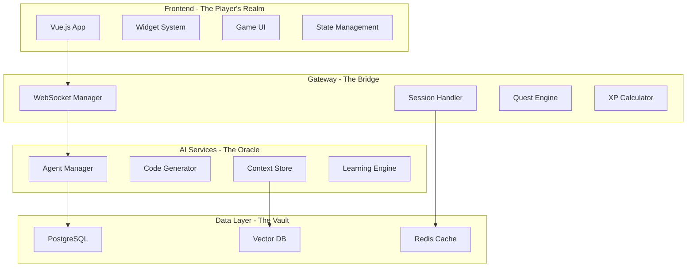

# 🏰 CodeCraft Platform Architecture

> **The Technical Foundation of Our Epic Quest**

## 🎯 Platform Overview

CodeCraft is built as a modern microservices architecture that seamlessly blends game mechanics with professional development tools. The platform consists of three main layers:

1. **Presentation Layer** - Vue.js game interface
2. **Orchestration Layer** - Node.js gateway with game logic
3. **Intelligence Layer** - Python AI services with multiple agents

## 🏗️ System Architecture



## 💻 Technology Stack

### Frontend Kingdom
- **Framework**: Vue 3 with Composition API
- **Language**: TypeScript (Level 10 Type Safety)
- **Build Tool**: Vite (Lightning Fast)
- **State**: Pinia (State Wizardry)
- **Styling**: Sass + Tailwind (Visual Magic)
- **Components**: 14+ Custom Widgets

### Gateway Fortress
- **Runtime**: Node.js v18+
- **Framework**: Express + TypeScript
- **Protocol**: WebSocket + HTTP
- **Communication**: gRPC Client
- **Session**: Redis-backed

### AI Oracle Tower
- **Language**: Python 3.11+
- **Framework**: Custom Agent System
- **Protocol**: gRPC Server
- **AI Integration**: OpenAI/Claude/Local
- **Vector Store**: Qdrant/Pinecone

### Data Dungeons
- **Primary DB**: PostgreSQL 15
- **Cache**: Redis 7
- **Vector DB**: Qdrant
- **File Storage**: Local/S3
- **Queue**: RabbitMQ (future)

## 🔄 Data Flow

### Player Action Flow
```
1. Player makes decision in UI
2. WebSocket sends to Gateway
3. Gateway validates and enriches
4. Quest Engine calculates XP
5. Request sent to AI Service
6. Agent processes request
7. Response streams back
8. UI updates with animation
9. Progress saved to database
```

### Real-time Communication
```typescript
// WebSocket message structure
interface GameMessage {
  type: 'quest' | 'combat' | 'dialogue' | 'reward'
  playerId: string
  sessionId: string
  data: {
    action: string
    context: any
    widget?: WidgetData
  }
  metadata: {
    timestamp: number
    questId?: string
    xpEarned?: number
  }
}
```

## 🎮 Core Services

### 1. Quest Engine
Manages all quest-related logic
- Quest generation
- Objective tracking
- Reward calculation
- Parallel quest execution

### 2. XP Calculator
Determines experience rewards
- Action-based XP
- Complexity multipliers
- Bonus calculations
- Level progression

### 3. Agent Orchestrator
Coordinates AI agents
- Agent selection
- Personality injection
- Collaboration management
- Response generation

### 4. Widget Manager
Controls interactive elements
- Widget lifecycle
- State synchronization
- Event handling
- Animation triggers

### 5. Achievement System
Tracks player accomplishments
- Achievement detection
- Progress tracking
- Unlock notifications
- Badge management

## 🔐 Security Architecture

### Authentication & Authorization
```typescript
interface PlayerAuth {
  playerId: string
  level: number
  permissions: Permission[]
  sessionToken: string
  refreshToken: string
}
```

### Security Layers
1. **Frontend Validation** - Input sanitization
2. **Gateway Protection** - Rate limiting, CORS
3. **Service Authentication** - JWT tokens
4. **Database Security** - Prepared statements
5. **AI Safety** - Prompt injection prevention

## 📊 Performance Optimization

### Caching Strategy
- **Redis**: Session data, player stats
- **CDN**: Static assets, widget templates
- **Browser**: Progressive caching
- **Database**: Query result caching

### Scaling Approach
- **Horizontal**: Multiple gateway instances
- **Vertical**: AI service GPU scaling
- **Auto-scaling**: Based on player count
- **Load Balancing**: Round-robin + sticky sessions

## 🌐 API Design

### RESTful Endpoints
```
POST   /api/player/register     # New player
GET    /api/player/profile      # Player stats
POST   /api/quest/start         # Begin quest
PUT    /api/quest/complete      # Finish quest
GET    /api/leaderboard         # Rankings
POST   /api/widget/interact     # Widget action
```

### WebSocket Events
```javascript
// Client -> Server
socket.emit('player:action', data)
socket.emit('quest:accept', questId)
socket.emit('agent:select', agentId)
socket.emit('widget:interact', widgetData)

// Server -> Client
socket.on('xp:gained', amount)
socket.on('level:up', newLevel)
socket.on('achievement:unlocked', achievement)
socket.on('quest:updated', questStatus)
```

### gRPC Services
```protobuf
service CodeCraftService {
  rpc ProcessAction(ActionRequest) returns (stream ActionResponse);
  rpc GenerateCode(CodeRequest) returns (CodeResponse);
  rpc GetAgentResponse(AgentRequest) returns (AgentResponse);
  rpc ExecuteWidget(WidgetRequest) returns (WidgetResponse);
}
```

## 🏛️ Database Schema

### Core Tables
```sql
-- Players
CREATE TABLE players (
  id UUID PRIMARY KEY,
  username VARCHAR(50) UNIQUE,
  email VARCHAR(255) UNIQUE,
  level INTEGER DEFAULT 1,
  xp INTEGER DEFAULT 0,
  class VARCHAR(50),
  created_at TIMESTAMP
);

-- Quests
CREATE TABLE quests (
  id UUID PRIMARY KEY,
  title VARCHAR(200),
  description TEXT,
  xp_reward INTEGER,
  quest_type VARCHAR(50),
  objectives JSONB,
  requirements JSONB
);

-- Player Progress
CREATE TABLE player_quests (
  player_id UUID REFERENCES players(id),
  quest_id UUID REFERENCES quests(id),
  status VARCHAR(20),
  progress JSONB,
  started_at TIMESTAMP,
  completed_at TIMESTAMP,
  PRIMARY KEY (player_id, quest_id)
);

-- Achievements
CREATE TABLE achievements (
  id UUID PRIMARY KEY,
  name VARCHAR(100),
  description TEXT,
  icon_url VARCHAR(500),
  xp_bonus INTEGER,
  rarity VARCHAR(20)
);

-- Widget Interactions
CREATE TABLE widget_logs (
  id UUID PRIMARY KEY,
  player_id UUID REFERENCES players(id),
  widget_type VARCHAR(50),
  action VARCHAR(100),
  data JSONB,
  xp_earned INTEGER,
  timestamp TIMESTAMP
);
```

## 🚀 Deployment Architecture

### Docker Compose (Development)
```yaml
version: '3.8'
services:
  frontend:
    build: ./frontend
    ports: ["5173:5173"]
  
  gateway:
    build: ./backend/gateway
    ports: ["3000:3000"]
    
  ai-service:
    build: ./backend/ai-services
    ports: ["50051:50051"]
    
  postgres:
    image: postgres:15
    volumes: ["pgdata:/var/lib/postgresql/data"]
    
  redis:
    image: redis:7
    ports: ["6379:6379"]
```

### Kubernetes (Production)
```yaml
apiVersion: apps/v1
kind: Deployment
metadata:
  name: codecraft-gateway
spec:
  replicas: 3
  selector:
    matchLabels:
      app: gateway
  template:
    spec:
      containers:
      - name: gateway
        image: codecraft/gateway:latest
        resources:
          requests:
            memory: "512Mi"
            cpu: "500m"
          limits:
            memory: "1Gi"
            cpu: "1000m"
```

## 📈 Monitoring & Analytics

### Metrics Collected
- Player engagement (quests/day)
- XP generation rate
- Widget usage patterns
- Agent interaction frequency
- Code generation quality
- System performance

### Monitoring Stack
- **Prometheus**: Metrics collection
- **Grafana**: Visualization
- **Sentry**: Error tracking
- **ELK Stack**: Log aggregation

## 🔧 Development Environment

### Prerequisites
```bash
# Required tools
node >= 18.0.0
python >= 3.11
docker >= 24.0
postgresql >= 15.0
redis >= 7.0
```

### Setup Commands
```bash
# Clone repository
git clone https://github.com/codecraft/codecraft

# Install dependencies
npm install          # Frontend
cd backend/gateway && npm install
cd backend/ai-services && pip install -r requirements.txt

# Start services
docker-compose up -d  # Database & Redis
npm run dev          # Frontend
npm run gateway      # Gateway
python server.py     # AI Service
```

## 🔗 Related Documentation

- [Current Implementation](../04-implementation/current-state.md)
- [API Reference](../05-api/README.md)
- [Deployment Guide](../06-deployment/README.md)
- [Development Roadmap](../07-roadmap/README.md)

---

*"A solid foundation for an epic adventure - where every component is a building block of legend."*